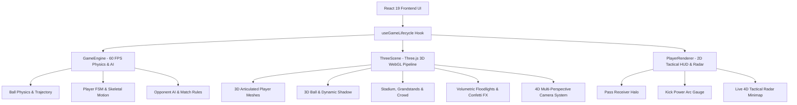

# ⚽ PitchSide 5v5 — 3D/4D Arcade Stadium Football

<div align="center">


[](https://vitejs.dev/)
[](https://react.dev/)
[](https://threejs.org/)
[](https://www.typescriptlang.org/)
[](https://tailwindcss.com/)
[](https://opensource.org/licenses/MIT)

**A high-octane 3D arcade football game built with Three.js, React 19, and TypeScript. Experience cinematic 4D camera perspectives, full 3D player models with real-time lighting and shadows, 5v5 tactical AI, ball physics with curve trajectory, and a live tactical radar minimap.**

[Live Demo](#-getting-started) · [Key Features](#-key-features) · [4D Camera Modes](#-4d-cinematic-camera-perspectives) · [Controls](#-controls-guide) · [Architecture](#-architecture--tech-stack)

</div>

---

## 🌟 Key Features

### 🏟️ Immersive 3D Stadium & Night Atmosphere
- **Three.js PBR Engine**: Physically-Based Rendering with ACESFilmic tone mapping, environmental reflection probes, and PCF soft shadows.
- **Volumetric Floodlight Beams**: Towering stadium floodlights with luminous light shafts cutting through the night stadium air.
- **Dynamic 3D Crowd**: Instanced crowd system with reactive spectators that perform the Mexican wave during play and erupt into celebration jumps when a goal is scored.
- **Procedural LED Boards & Turf**: Crisp pitch grass patterns, realistic goal nets, team dugouts, and animated stadium perimeter banners.

### 🏃 Real-Time 3D Articulated Players & Ball
- **Full 3D Character Models**: Styled 3D footballers with team kit jerseys, printed squad numbers, customizable skin tones, hairstyles, shorts, socks, and athletic boots.
- **Procedural Skeletal Animation**: Fluid running strides, sprint leans, slide tackle ground animations, kicking leg swings, and victory celebration leaps.
- **3D Soccer Ball Aerodynamics**: Realistic 32-panel textured football rolling with authentic angular momentum, spin-induced curve trajectories, height bounces, and dynamic contact shadows.
- **3D Speed Trail & Impact Effects**: Supersonic trail streaks on power shots and radial shockwaves on pitch bounces.
- **Goal Celebration Confetti**: 300+ physics-driven colorful confetti ribbons burst over the scoring goal mouth when you score!

### 🗺️ Live 4D Tactical Radar Minimap
- **Real-Time Pitch Radar**: High-contrast glassmorphic mini-pitch on screen tracking all 10 players and the ball in real time.
- **Player Indicators**: Team-colored position blips, active player targeting rings, pass receiver candidate highlights, and kick charge power gauges.

---

## 🎥 4D Cinematic Camera Perspectives

Switch between 4 camera perspectives anytime during the match with the **`V` key** or the **Camera icon** on the scoreboard:

| Camera Mode | Description | Ideal For |
| :--- | :--- | :--- |
| **`Broadcast 3D`** | Smooth TV broadcast sideline camera with intelligent ball tracking and dynamic field framing. | Classic matchday TV broadcast feel |
| **`Action 3D`** | Immersive 3rd-person follow cam close behind your active player that turns with your movement. | Intense arcade action & dribbling |
| **`Endline 3D`** | Behind-the-goal camera positioned behind the nets looking straight downfield. | Long-range shooting & finishing |
| **`Tactical 4D`** | High-altitude panoramic birds-eye view covering the entire pitch layout. | Strategic formation management & vision |
| **`Goal Orbit`** | Automatic cinematic slow-motion orbit around the goalscorer during celebrations! | Replay glory moments |

---

## 🎮 Controls Guide

Full keyboard and mobile touch support out of the box:

### ⌨️ Keyboard Controls
| Action | Primary Key | Secondary Key |
| :--- | :--- | :--- |
| **Move Player** | `W`, `A`, `S`, `D` | Arrow Keys |
| **Sprint** | `Shift` (Hold) | `Shift` |
| **Pass / Low Cross** | `K` | `X` / `Enter` |
| **Shoot / Power Clearance** | `Space` (Hold to charge) | `J` |
| **Switch Player / Slide Tackle** | `Tab` | `C` / `Q` |
| **Cycle 3D/4D Camera** | `V` | Scoreboard Camera Icon |
| **Pause / Resume** | `Escape` | `P` |

### 📱 Touch & Mobile Controls
- **Virtual Analog Joystick**: Floating on-screen joystick for smooth 360° directional running.
- **Action Buttons**: Dedicated touch buttons for **Pass**, **Shoot** (with visual power gauge), **Sprint**, and **Switch/Tackle**.

---

## 🧠 Tactical AI & Game Engine

- **Zonal Defending & Pressing**: Opponent defenders dynamically mark passing lanes, apply pressure to the ball carrier, and execute sliding tackles.
- **Intelligent Goalkeepers**: Keepers patrol their 6-yard box, adjust their angles relative to the ball, and make diving parries against driven shots.
- **Teammate Offensive Runs**: Forwards and midfielders make diagonal supporting runs into space, anticipating through balls and crosses.
- **Authentic Match Rules**: Full match clock, throw-ins, goal kicks, corner kicks, and kickoff restarts.

---

## 🛠️ Architecture & Tech Stack



### Tech Stack:
- **Core Framework**: React 19 + TypeScript
- **3D Graphics Engine**: Three.js (r186)
- **Styling**: Tailwind CSS v4 + Lightning CSS
- **Build System**: Vite 8
- **Icons**: Lucide React

---

## 🚀 Getting Started

### Prerequisites
- [Node.js](https://nodejs.org/) (version 18 or higher recommended)
- `npm`

### Installation

1. **Clone the repository:**
   ```bash
   git clone https://github.com/123bruke/Predictive-Football_game.git
   cd Predictive-Football_game
   ```

2. **Install dependencies:**
   ```bash
   npm install
   ```

3. **Start the local development server:**
   ```bash
   npm run dev
   ```
   Open your browser at **`http://localhost:3000`**

4. **Build for production:**
   ```bash
   npm run build
   npm run preview
   ```

---

## 📁 Project Directory Structure

```
pitchside-5v5/
├── src/
│   ├── components/
│   │   ├── GameControls.tsx      # On-screen mobile touch joystick & action buttons
│   │   ├── MainMenu.tsx          # Match setup, kit selector & controls drawer
│   │   ├── MatchResult.tsx       # Post-match summary, scoreline & stats
│   │   ├── PauseMenu.tsx         # In-game pause menu with camera switchers
│   │   └── Scoreboard.tsx        # Broadcast scoreboard, camera toggle & clock
│   ├── game/
│   │   ├── Ball.ts               # Ball state, roll friction, curve & impacts
│   │   ├── Collision.ts          # Ball-player, post & pitch boundary collision
│   │   ├── FootballRules.ts      # Throw-ins, goal kicks, corners & kickoff logic
│   │   ├── GameEngine.ts         # Main game coordinator, phases & player roster
│   │   ├── GameLoop.ts           # Fixed-timestep physics update & render loop
│   │   ├── InputController.ts    # Dual-input keyboard & mobile touch controller
│   │   ├── OpponentAI.ts         # Tactical AI behavior tree, marking & shooting
│   │   ├── Player.ts             # Player state, attributes, stamina & animations
│   │   └── Team.ts               # Squad rosters, kits & formation anchors
│   ├── hooks/
│   │   └── useGameLifecycle.ts   # React lifecycle hook binding Three.js & engine
│   ├── rendering/
│   │   ├── Ball3DMesh.ts         # 3D soccer ball mesh, rolling & speed trail
│   │   ├── ConfettiFX.ts         # 3D celebration confetti cannon simulation
│   │   ├── PitchRenderer.ts      # High-res procedural pitch markings & turf
│   │   ├── Player3DMesh.ts       # 3D articulated player model with team kits
│   │   ├── PlayerRenderer.ts     # 2D canvas tactical HUD & live radar minimap
│   │   ├── StadiumRenderer.ts    # 3D grandstands, roofs, crowd & goal frames
│   │   ├── ThreeScene.ts         # Three.js scene, lighting, 4D camera & renderer
│   │   └── VolumetricLighting.ts # Atmospheric floodlight light shafts
│   ├── types/
│   │   └── game.ts               # Core TypeScript interfaces & state types
│   ├── App.tsx                   # Main root application layout
│   └── main.tsx                  # React entry point
├── index.html                    # HTML shell & Google Fonts preloads
├── package.json                  # Cleaned dependency manifest
├── tsconfig.json                 # Modern TypeScript configuration
├── vite.config.ts                # Vite 8 config with Tailwind v4 & React
└── README.md                     # Comprehensive project documentation
```

---

## 🤝 Contributing

Contributions, issues, and feature requests are welcome!
1. Fork the Project
2. Create your Feature Branch (`git checkout -b feature/AmazingFeature`)
3. Commit your Changes (`git commit -m 'Add some AmazingFeature'`)
4. Push to the Branch (`git push origin feature/AmazingFeature`)
5. Open a Pull Request

---

## 📄 License

Distributed under the **MIT License**. See `LICENSE` for more information.

<div align="center">
  <sub>Created with ❤️ for football & 3D gaming enthusiasts worldwide.</sub>
</div>
